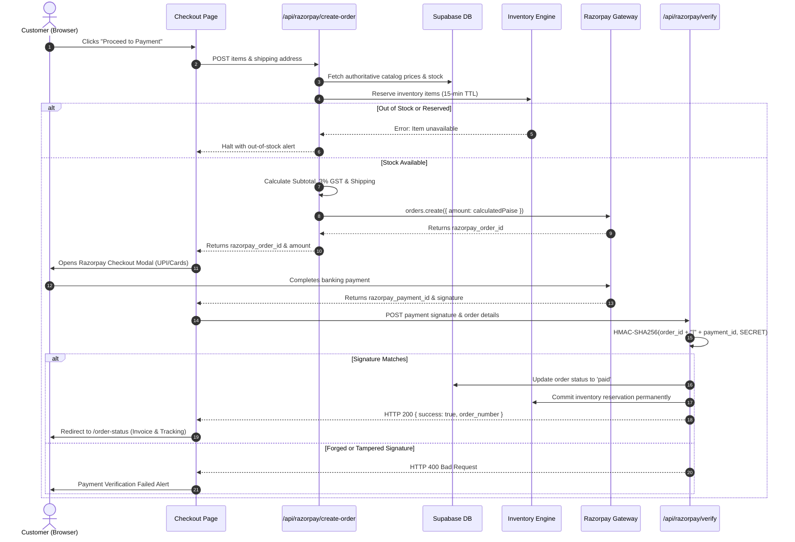
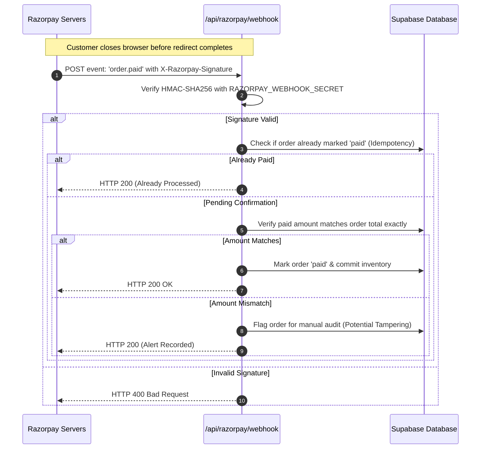
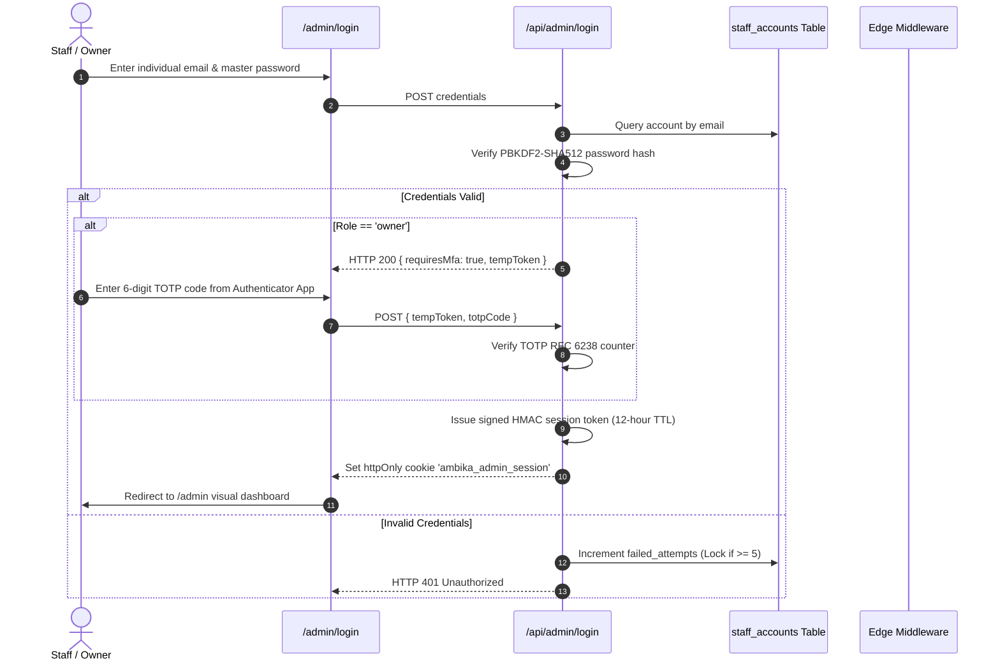

# CRITICAL APPLICATION FLOWS

---

## 1. Secure Customer Checkout & Payment Capture Flow

---

## 2. Asynchronous Webhook Reconciliation Flow (Browser Drop-Off Defense)

---

## 3. Zero-Trust Admin Authentication & MFA Flow

