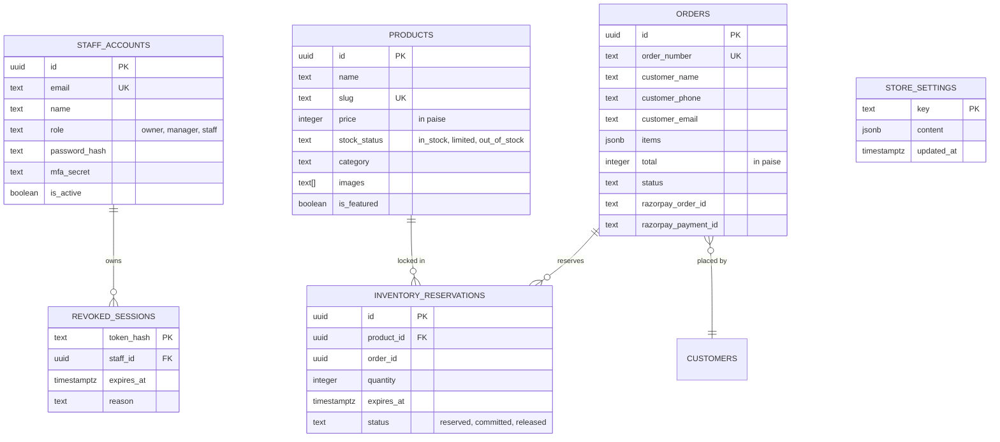

# DATABASE ARCHITECTURE & SCHEMA SPECIFICATION

> **Database Engine:** Supabase PostgreSQL 15+  
> **Security Model:** Strict Row-Level Security (RLS) with Service-Role Isolation.

---

## 1. Relational Entity Overview

---

## 2. Table Definitions & Invariants

### 1. `products`
- **Primary Key:** `id` (UUID).
- **Price Invariant:** Stored in **paise** (integer) to avoid floating-point math inaccuracies (e.g. ₹1,45,000 = `14500000`).
- **Indexes:** `idx_products_category`, `idx_products_featured`, `idx_products_price`.
- **RLS Policy:** Public anonymous reads allowed (`SELECT WHERE true`). Insert, update, and delete restricted to authenticated service-role only.

### 2. `orders`
- **Primary Key:** `id` (UUID).
- **Order Number:** Human-readable unique code (e.g. `AMB-20261110-XXXX`).
- **Items:** JSONB array containing snapshots of product IDs, names, unit prices, and quantities at the exact moment of order creation.
- **RLS Policy:** Anonymous users cannot read orders by default. Order lookup requires matching phone number and tracking token via `/api/track` (IDOR defense).

### 3. `staff_accounts`
- **Roles:**
  - `owner`: Full privileges, managing staff, changing financial settings, requires TOTP MFA.
  - `manager`: Catalog, order management, rate adjustments.
  - `staff`: Counter POS, order lookup, packing slip printing.
- **Passwords:** Derived with PBKDF2-SHA512 (100,000 iterations) with cryptographic per-account salts.
- **Brute-Force Guard:** 5 consecutive failed attempts trigger a 15-minute account lock.

### 4. `revoked_sessions`
- **Purpose:** Distributed, persistent session revocation across all serverless compute instances.
- **Cleanup:** Expired revocation records are automatically purged after session maximum lifetime (12 hours).

### 5. `inventory_reservations`
- **Purpose:** Atomic concurrency control preventing double-selling of one-of-a-kind jewellery pieces.
- **TTL:** Checkout holds stock for 15 minutes. Automatically released if payment is aborted or fails.
