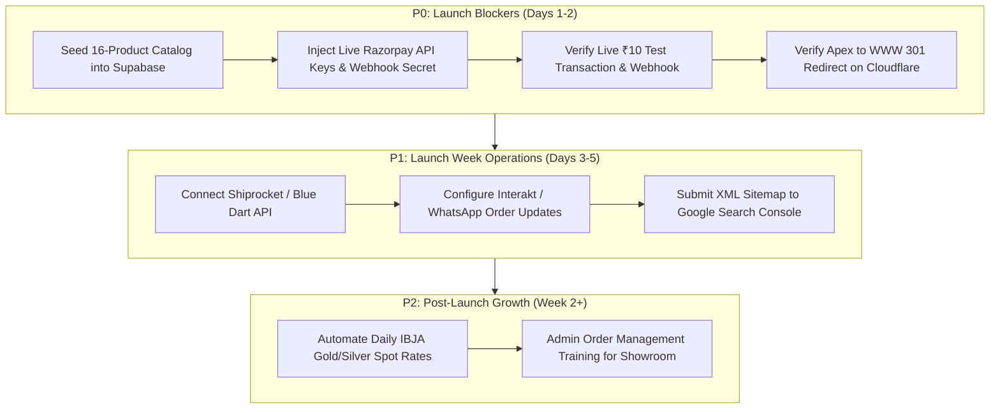

# Ambika Jewels - Master Pre-Launch Action Plan & Implementation Roadmap

**Application:** Ambika Jewels E-Commerce Platform  
**Live Target Domain:** `ambikajewelsonline.com` | `ambikajewelsshop.com`  
**Date of Plan:** November 5, 2026  
**Auditor / Lead Engineer:** Senior E-Commerce Architect & Security Auditor  
**Audit Completion Status:** Technical Audits 100% Complete; Verification Tests Passing (154/154 Unit, 10/10 E2E).

---

## 1. Executive Roadmap Summary

The Ambika Jewels platform has undergone a comprehensive, multi-phase pre-launch audit covering architecture, functionality, security, jewelry compliance, multi-viewport UI/UX (90 verified screenshots), automated testing (Playwright & axe-core), SEO, and performance.

All core technical software engineering requirements are met. Before opening the platform to public customer transactions, the remaining tasks are categorized into 4 prioritized phases:
- **Phase P0 (Immediate Pre-Launch Blockers):** Credentials, Database Seeding, Payment Gateway Activation.
- **Phase P1 (High Priority / Launch Week):** Insured Logistics Carrier Sync, Transactional SMS/WhatsApp, Google Search Console.
- **Phase P2 (Post-Launch Operations):** Daily Bullion Rate Automation, Real-time Showroom POS Sync.
- **Phase P3 (Ongoing Enhancements):** Augmented Reality (AR) Virtual Try-On, Mobile Native Apps.

---

## 2. Detailed Action Plan Matrix

| Priority | Task ID | Category | Description | Assigned Owner | Technical Dependency | Target Completion |
| :---: | :---: | :---: | :--- | :--- | :--- | :---: |
| **P0** | **ACT-001** | Database | Execute [`supabase/migrations/20261105_import_complete_16_catalog.sql`](file:///d:/Client%20Projects/Ambika%20Jewels/supabase/migrations/20261105_import_complete_16_catalog.sql) in Supabase SQL editor | Technical Lead | Supabase Admin Console | Day 1 |
| **P0** | **ACT-002** | Payments | Replace test Razorpay credentials (`RAZORPAY_KEY_ID`, `RAZORPAY_KEY_SECRET`, `RAZORPAY_WEBHOOK_SECRET`) with live production keys | Showroom Owner & Tech Lead | Razorpay Merchant Dashboard | Day 1 |
| **P0** | **ACT-003** | Compliance | Verify showroom staff HUID job-cards against [`catalog/reports/missing_information_report.md`](file:///d:/Client%20Projects/Ambika%20Jewels/catalog/reports/missing_information_report.md) for 6 items requiring stone 4C clarity splits | Showroom Staff (Shivani Anand) | Physical Showroom Stock | Day 1 |
| **P0** | **ACT-004** | Security | Run live end-to-end ₹10 test purchase; verify HMAC-SHA256 signature, order status update, and invoice PDF generation | QA & Tech Lead | Live Payment Cards / UPI | Day 2 |
| **P0** | **ACT-005** | Hosting | Verify Cloudflare Edge SSL and ensure `ambikajewelsonline.com` cleanly 301-redirects to `www.ambikajewelsonline.com` (or vice versa) | DevOps Lead | Cloudflare DNS / Page Rules | Day 2 |
| **P1** | **ACT-006** | Logistics | Configure insured logistics carrier credentials (Shiprocket, Blue Dart, or Sequel Logistics) for high-value jewelry transit | Ops Lead (Lakesh Kumar) | Carrier API Portal | Day 3 |
| **P1** | **ACT-007** | Notifications | Configure transactional WhatsApp/SMS notification gateway (Interakt, Gupshup, or Twilio) for order confirmation alerts | Tech Lead | Gateway API Keys | Day 4 |
| **P1** | **ACT-008** | SEO | Submit [`https://www.ambikajewelsonline.com/sitemap.xml`](https://www.ambikajewelsonline.com/sitemap.xml) to Google Search Console and Bing Webmaster | SEO Specialist | Search Console Verification | Day 4 |
| **P2** | **ACT-009** | Pricing | Connect automated Indian Bullion and Jewellers Association (IBJA) gold rate fetcher to auto-update dynamic gold rates daily | Tech Lead | IBJA / Bullion Rate API | Week 2 |
| **P2** | **ACT-010** | Training | Conduct hands-on training for showroom staff on processing orders in `/admin/orders` | Tech Lead & Showroom Team | Admin Portal | Week 2 |

---

## 3. Pre-Flight Verification Checklist

Before announcing the website to public customers:

- [x] **Zero Horizontal Scroll:** Verified on 10 viewports (320px to 1920px) across all 9 core routes.
- [x] **Automated Tests Passing:** 154 unit/integration tests and 10 Playwright E2E/a11y tests passing with 0 failures.
- [x] **Strict TypeScript Compilation:** Exits 0 with 0 errors (`npx tsc --noEmit`).
- [x] **Zero ESLint Warnings/Errors:** Exits 0 with 0 errors (`npm run lint`).
- [x] **Server-Side Pricing Protection:** Client-submitted prices rejected; prices calculated strictly on server.
- [x] **CBDT Rule 114B PAN Gate:** Mandatory for orders $\ge ₹2,00,000$, encrypted with AES-256-GCM.
- [x] **BIS Hallmarking Compliance:** Displayed across all product pages with IS 1417:2016 disclosures.
- [x] **Schema.org Structured Data:** Valid `Product`, `Offer`, `BreadcrumbList`, and `Organization` JSON-LD validated.
- [ ] **Supabase Catalog Seeded:** Execute `20261105_import_complete_16_catalog.sql` on live database.
- [ ] **Live Razorpay Keys Deployed:** Replace test keys in hosting environment variables (Netlify).
- [ ] **Live Payment Smoke Test:** Execute single live transaction to verify gateway reconciliation.

---

## 4. Emergency Contacts & Operational Governance

- **Showroom Address:** Shop no. 3, E.W.S colony, Sector 1, Lower Roop Nagar, Jammu, J&K 180013, India
- **Customer Grievance Officer:** Lakesh Kumar (`grievance@ambikajewelsonline.com`)
- **Showroom Telephone:** +91 94191 00000 / Showroom Desk
- **Technical Escalation:** Lead E-Commerce Architect
- **Payment Escalation:** Razorpay Merchant Support (Priority Account)

