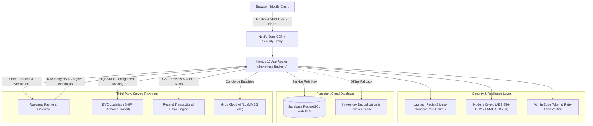
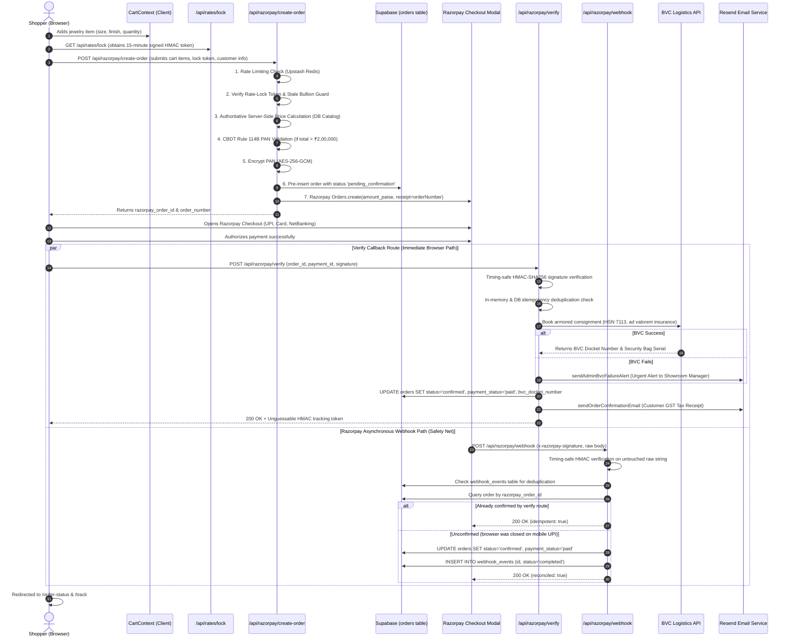

# Ambika Jewels — Pre-Launch Architecture & Discovery Audit
**Document ID:** `docs/audit/PROJECT_OVERVIEW.md`  
**Audit Date:** November 2026  
**Auditor / Roles:** Senior E-Commerce Architect, Full-Stack Engineer, QA Automation Engineer, Security Auditor  
**Project Version:** 1.0.2  
**Target Domain:** `ambikajewelsshop.com` / `ambikajewelsonline.com`  
**Git Branch:** `audit/pre-launch-discovery`

---

## Executive Summary

Ambika Jewels is a bespoke, luxury e-commerce showroom and counter operations platform engineered for a premier fine jewelry retail house based in Lower Roop Nagar, Jammu, India. The application serves two core operational functions:
1. **Public E-Commerce Storefront:** Enables national fine jewelry clients to browse authentic BIS-hallmarked 22K/18K/14K gold, certified diamonds, and 925 sterling silver; lock in daily precious bullion rates; securely checkout with Indian payment methods (UPI, Cards, NetBanking); and monitor insured armored transit via BVC Logistics.
2. **In-Store Showroom Counter POS (`/admin`):** Enables showroom personnel to update daily Jammu bullion rates with automatic sanity bounds, generate GST-compliant itemized billing with thermal receipt printing, manage online orders, and operate secure counter utilities.

This document represents **Phase 1: Complete Project Discovery**, capturing an exhaustive, evidence-backed inspection of the codebase, runtime configurations, database models, route handlers, test suites, third-party integrations, confirmed bugs, and pre-launch risks.

---

## 1. Technology Stack & Environment

| Component | Technology | Version / Specification | Architectural Purpose |
| :--- | :--- | :--- | :--- |
| **Framework** | Next.js (App Router) | `16.2.10` (Turbopack) | Server Components, dynamic Route Handlers, Edge Proxy, SEO metadata |
| **Runtime & UI** | React | `19.2.4` | Component lifecycle, modern hooks, server rendering |
| **Language** | TypeScript | `^5` (Strict mode) | Complete end-to-end type safety (`npx tsc --noEmit` passing 100%) |
| **Styling** | Tailwind CSS v4 | `@tailwindcss/postcss ^4` | Custom luxury gold tokens, CSS variables, glassmorphism, responsive grids |
| **Database** | PostgreSQL / Supabase | `@supabase/supabase-js ^2.110.7` | Relational storage, Row-Level Security (RLS), foreign key integrity |
| **ORM / Client** | Supabase Admin Client | Server-only singleton | Privileged database writes using `SUPABASE_SERVICE_ROLE_KEY` |
| **Payment Gateway** | Razorpay Node SDK | `razorpay: ^2.9.8` | Order creation, HMAC-SHA256 signature verification, raw-body webhooks |
| **Armored Logistics**| BVC Logistics eSHIP API | Custom REST client | High-value jewelry delivery, ad valorem transit insurance, tamper bags |
| **Secondary Logistics**| Shiprocket REST API v2| External REST client | Standard courier fallback and consignment booking |
| **Transactional Email**| Resend API | Custom REST client | Automated GST tax receipts, order confirmations, admin emergency alerts |
| **Bullion Ticker** | GoldAPI.io | External API feed | Live spot bullion pricing with local Jammu database fallback |
| **Distributed Cache**| Upstash Redis | `@upstash/redis ^1.39.0`, `@upstash/ratelimit ^2.2.0` | Sliding-window distributed rate limiting across serverless instances |
| **AI Concierge** | Groq Cloud | LLaMA 3.3 70B Versatile | "Aanya" AI shopping assistant with PII redaction and prompt-injection defense |
| **Hosting & CDN** | Netlify | `@netlify/plugin-nextjs ^5.15.13` | Edge network, serverless functions, automatic deployment |

---

## 2. Application Architecture & Data Flow

### 2.1 System Architecture Diagram

### 2.2 End-to-End E-Commerce Transaction Pipeline

---

## 3. Database Schema & Architecture

The database architecture is designed in PostgreSQL and deployed via Supabase. It features strict Row-Level Security (RLS), triggers, and explicit financial data types.

### 3.1 Primary Tables & Entities

#### 1. `products`
* `id` (`UUID`, PK, default `uuid_generate_v4()`)
* `name` (`TEXT`, NOT NULL)
* `slug` (`TEXT`, UNIQUE, NOT NULL)
* `description` (`TEXT`, NOT NULL)
* `price` (`INTEGER`, NOT NULL) — **Price in paise** (`₹1,45,000` = `14500000`)
* `display_price` (`TEXT`, NOT NULL) — Formatted string (`₹1,45,000`)
* `category` (`TEXT`, NOT NULL, indexed)
* `images` (`TEXT[]`, array of image URLs)
* `badges` (`TEXT[]`, e.g. `["22K BIS", "DOGRA HERITAGE"]`)
* `metal_finishes` (`TEXT[]`, e.g. `["Gold", "Antique Gold"]`)
* `stock_status` (`TEXT`, CHECK `in_stock`, `limited`, `out_of_stock`)
* `is_featured` (`BOOLEAN`, default `FALSE`, indexed)
* `collection` (`TEXT`, default `'Heritage'`)
* `craftsmanship_story` (`TEXT`)
* `created_at`, `updated_at` (`TIMESTAMPTZ`)

#### 2. `orders`
* `id` (`UUID`, PK)
* `order_number` (`TEXT`, UNIQUE, NOT NULL) — Cryptographically unguessable (`AMB-XXXXX-XXXXXXXX`)
* `customer_name` (`TEXT`, NOT NULL)
* `customer_phone` (`TEXT`, NOT NULL, indexed)
* `customer_email` (`TEXT`, indexed)
* `shipping_address` (`TEXT`, NOT NULL)
* `pincode` (`TEXT`)
* `items` (`JSONB`, NOT NULL) — Snapshot of products, quantities, prices, and selected sizes
* `subtotal` (`INTEGER`, paise)
* `tax` (`INTEGER`, paise, statutory 3% GST)
* `shipping` (`INTEGER`, paise, ₹500 flat or ₹0 above ₹50,000 threshold)
* `total` (`INTEGER`, paise)
* `status` (`TEXT`, CHECK `pending_confirmation`, `confirmed`, `processing`, `shipped`, `delivered`, `cancelled`)
* `payment_method` (`TEXT`, e.g. `'razorpay'`)
* `payment_status` (`TEXT`, CHECK `unpaid`, `paid`, `refunded`)
* `razorpay_order_id` (`TEXT`, UNIQUE, indexed)
* `razorpay_payment_id` (`TEXT`, UNIQUE, indexed)
* `pan_number` (`TEXT`) — **Encrypted using AES-256-GCM**
* `shipping_provider` (`TEXT`, default `'bvc'`)
* `tracking_awb` (`TEXT`, indexed)
* `bvc_docket_number` (`TEXT`, indexed)
* `bvc_shipment_id` (`TEXT`)
* `bvc_status` (`TEXT`, default `'pending'`)
* `bvc_security_bag_number` (`TEXT`)
* `notes` (`TEXT`)
* `created_at`, `updated_at` (`TIMESTAMPTZ`)

#### 3. `daily_rates` (Jammu Showroom Bullion Tracker)
* `id` (`UUID`, PK)
* `gold_24k` (`NUMERIC`, NOT NULL, default `7850`)
* `gold_22k` (`NUMERIC`, NOT NULL, default `7190`)
* `gold_18k` (`NUMERIC`, NOT NULL, default `5888`)
* `gold_14k` (`NUMERIC`, NOT NULL, default `4592`)
* `silver_999` (`NUMERIC`, NOT NULL, default `92`)
* `silver_925` (`NUMERIC`, NOT NULL, default `85`)
* `updated_at` (`TIMESTAMPTZ`, default `NOW()`)
* `updated_by` (`TEXT`, default `'Shopkeeper'`)

#### 4. `webhook_events` (Replay Protection & Audit Log)
* `id` (`TEXT`, PK) — Razorpay webhook event ID
* `source` (`TEXT`, e.g. `'razorpay'`, `'bvc'`)
* `event_type` (`TEXT`, e.g. `'payment.captured'`)
* `payload` (`JSONB`)
* `created_at` (`TIMESTAMPTZ`)

#### 5. `customer_savings_goals`
* `id` (`UUID`, PK)
* `customer_name` (`TEXT`), `customer_phone` (`TEXT`), `event_name` (`TEXT`)
* `target_weight_grams` (`NUMERIC`), `target_amount_rupees` (`NUMERIC`)
* `payments` (`JSONB`, installment history)
* *(Note: Public access disabled; feature flag currently turned off pending corporate/legal clearance)*

#### 6. `faq_items`
* Knowledge base questions, answers, and keyword arrays consumed by the chatbot and FAQ pages.

---

## 4. Complete Application Routes & Endpoints Directory

The application exposes **44 total routes** (static pages, dynamic SSR routes, and protected API endpoints):

### 4.1 Storefront Pages (Public)
1. `GET /` — Flagship landing page: Hero, Dogra heritage storytelling, category grid, best sellers, virtual try-on banner, client testimonials, BIS hallmark trust badges.
2. `GET /collections` — Catalog browser: Category filtering (Dogra Heritage, Gold, Diamonds, Silver, Bridal), price sort, responsive card grid.
3. `GET /collections/[slug]` — Product Detail Page (PDP): Image gallery with zoom, purity badge, HUID notice, Indian ring/bangle size selectors, metal finish switcher, making charges transparency, add-to-cart, and WhatsApp concierge trigger.
4. `GET /cart` — Shopping bag: Subtotal, 3% GST calculation, shipping threshold notice, bullion rate protection ribbon, item quantity management, order notes.
5. `GET /checkout` — Multi-step checkout: Delivery address validation, phone number normalization, email domain typo correction, conditional Rule 114B PAN input (>₹2L), 15-minute rate-lock countdown timer, Razorpay checkout launcher.
6. `GET /order-status` — Order confirmation view: GST tax invoice receipt, breakdown of CGST/SGST/IGST, printable invoice, courier dispatch status.
7. `GET /track` — Consignment tracking: IDOR-protected lookup requiring Order Number + Phone/Email/Token; displays BVC Logistics armored transit stages and masked addresses.
8. `GET /about` — Showroom history, founders Shivani Anand & Lakesh Kumar, Dogra karigar heritage, Lower Roop Nagar showroom coordinates.
9. `GET /services` — Showroom services: Transparent gold exchange, heirloom melting, 3D CAD bespoke design, certified diamond setting.
10. `GET /contact` — Showroom map coordinates, timings, WhatsApp concierge button, phone contacts.
11. `GET /tools` — Digital gold calculator and jewelry care guide.
12. `GET /authenticity` — BIS hallmarking guide, 6-character HUID verification guide, diamond certification standards (GIA/IGI).

### 4.2 Legal & Statutory Compliance Pages
13. `GET /shipping-policy` — Indian shipping terms, BVC Logistics armored transit, insurance coverage, 2–4 day pan-India timeline.
14. `GET /refund-policy` — 7-day inspection and return terms, conditions for returnable vs bespoke jewelry.
15. `GET /exchange-policy` — Lifetime buyback and exchange terms based on daily bullion rates and XRF purity testing.
16. `GET /custom-orders-policy` — 3D CAD design approval process, non-refundable deposit terms for custom fabrication.
17. `GET /privacy-policy` — Indian IT Act & DPDP Act 2023 compliant privacy disclosures.
18. `GET /terms` — E-commerce terms of service, precious metal pricing disclaimers, jurisdiction (Jammu courts).
19. `GET /seller-info` — Mandatory Consumer Protection (E-Commerce) Rules seller disclosures: Legal business name, GSTIN, PAN, BIS license, Nodal Officer.
20. `GET /grievance-policy` — Statutory Grievance Redressal mechanism: Officer contact, 48-hour acknowledgement, 30-day resolution window.
21. `GET /data-request` — Digital Personal Data Protection (DPDP) customer rights portal (access, correction, erasure).

### 4.3 Administrative & Showroom Counter Pages (Protected)
22. `GET /admin` — Central operations console: Overview metrics, catalog inventory manager, online order feed, bullion rate updater, POS switcher.
23. `GET /admin/login` — Administrator authentication gateway: Constant-time passcode verification, rate-limited against brute-force attacks.
24. `GET /admin/counter` — Showroom POS counter billing terminal: Net metal weight calculation, making charge compute, 3% GST calculation, 80mm/58mm thermal receipt printing.
25. `GET /admin/orders` — Online order oversight screen: Filter orders by status and provider, update delivery stages, assign BVC docket numbers.

### 4.4 Backend REST API Endpoints
26. `POST /api/razorpay/create-order` — Authoritative server pricing, 15-minute rate-lock token check, stale bullion rate check, Rule 114B PAN gate, pre-inserts pending order into Supabase, calls Razorpay API.
27. `POST /api/razorpay/verify` — Validates Razorpay HMAC-SHA256 signature, enforces idempotency, books BVC Logistics consignment, updates Supabase order to 'confirmed', dispatches Resend email receipt.
28. `POST /api/razorpay/webhook` — Asynchronous safety net: Timing-safe HMAC verification on raw body, persistent idempotency via `webhook_events`, reconciles mobile UPI drop-offs.
29. `GET /api/rates/lock` — Issues a cryptographically signed HMAC token locking bullion prices for 15 minutes.
30. `GET /api/track` — Anti-IDOR tracking endpoint: Validates phone/email/token against database order, masks delivery address, returns BVC transit stages.
31. `POST /api/chat` — AI jewelry concierge endpoint powered by Groq LLaMA 3.3 70B: Sanitizes input, enforces PII redaction, blocks prompt injection, grounds answers in store knowledge.
32. `POST /api/orders` — Guest order intake endpoint for direct WhatsApp showroom inquiries.
33. `GET /api/shipping/serviceability` — Evaluates delivery pincode against BVC Logistics armored service areas.
34. `GET /api/silver/price` — Returns wholesale silver rates from GoldAPI with local database fallback.
35. `POST /api/data-request` — Receives and logs customer DPDP Act data requests.
36. `POST /api/bvc/webhook` — Ingests live transit status updates from BVC Logistics (vaulted, in-transit, out for delivery).
37. `POST /api/admin/login` — Validates admin credentials via constant-time comparison, sets 12-hour HttpOnly session cookie.
38. `GET /api/admin/check-auth` — Edge/server session check verifying active admin authentication status.
39. `POST /api/admin/logout` — Destroys admin session cookie.
40. `GET /api/admin/orders` — Fetches online store orders with customer PII (protected, admin session required).
41. `PATCH /api/admin/orders` — Updates order status and assigns courier docket numbers (protected).
42. `POST /api/admin/orders/bvc` — Dispatches manual BVC shipment booking from admin panel.
43. `GET /api/admin/products` — Fetches catalog inventory with search and category filters (protected).
44. `POST /api/admin/products`, `PATCH /api/admin/products`, `DELETE /api/admin/products` — Full CRUD product catalog management (protected).
45. `POST /api/admin/rates` — Updates showroom gold and silver bullion rates with sanity deviation checks (protected).
46. `GET /api/admin/savings-goals`, `POST /api/admin/savings-goals` — Savings goal management (protected).

---

## 5. Security Architecture & Threat Mitigations

The project has undergone rigorous security hardening:
* **Zero Hardcoded Secrets:** All cryptographic keys, database URLs, payment secrets, and API credentials are read from environment variables. Missing variables in production trigger immediate application termination (`src/lib/env.ts`).
* **Authoritative Server-Side Pricing (`src/lib/serverPricing.ts`):** Client-submitted prices are completely disregarded. Prices are calculated exclusively on the server using authoritative database catalog records, enforcing 3% GST and proper shipping rules.
* **Cryptographic Rate-Lock (`src/lib/rateLock.ts`):** Checkout prices are bound to a 15-minute window via an HMAC-SHA256 token containing the rate timestamp, preventing stale checkout prices.
* **Raw-Body Webhook Verification (`src/app/api/razorpay/webhook/route.ts`):** Webhook signatures are computed over the untouched raw body string and compared using `crypto.timingSafeEqual`.
* **Database & Memory Idempotency:** Duplicate payment verification or webhook replays are prevented via a dual-layer deduplication cache and database unique constraints on `razorpay_payment_id`.
* **CBDT Rule 114B Statutory PAN Gate:** Purchases exceeding ₹2,00,000 enforce a mandatory PAN card requirement. PAN strings are encrypted using AES-256-GCM (`src/lib/encryption.ts`) and never logged or exposed to third parties.
* **Anti-IDOR Consignment Tracking (`src/app/api/track/route.ts`):** Order lookup strictly requires the Order Number plus customer phone, email, or an HMAC access token. Public responses mask street addresses (`H. No. 1***, G*** Nagar`).
* **Strict Admin Session Management (`src/lib/adminAuth.ts` & `src/middleware.ts`):** Admin session tokens use Web Crypto HMAC-SHA256 with an enforced 12-hour TTL and HttpOnly cookies.
* **PII Redaction & Sanitization (`src/lib/logger.ts` & `src/app/api/chat/route.ts`):** Indian mobile numbers, email addresses, and PAN numbers are redacted before logging or sending prompts to external AI APIs.
* **Content Security Policy (CSP):** `next.config.ts` enforces frame ancestors, script whitelisting (Razorpay), strict HSTS (`max-age=63072000; includeSubDomains; preload`), `X-Frame-Options: DENY`, and `X-Content-Type-Options: nosniff`.

---

## 6. Diagnostic Health Checks & Verification Results

| Diagnostic Check | Executed Command | Exit Status | Result Summary | Evidence / Log Reference |
| :--- | :--- | :--- | :--- | :--- |
| **Unit & Integration Tests** | `npm test` | **PASS (0)** | **131 tests passing**, 52 suites, 0 failures, 0 skipped (duration: 5.92s) | `tsx --test tests/**/*.test.ts` |
| **TypeScript Compilation** | `npx tsc --noEmit` | **PASS (0)** | **0 errors**. Full static type safety across all components and handlers | `tsconfig.json` |
| **Statutory Disclosure Check**| `npm run check-production` | **PASS (0)** | Verified GSTIN, PAN, BIS License, Legal Name, Entity Type | `scripts/check-production-placeholders.mjs` |
| **Production Build** | `npm run build` | **PASS (0)** | **Turbopack compiled successfully in 28.9s**. 44 pages & endpoints generated | `.next` production bundle |
| **ESLint Static Analysis** | `npm run lint` | **FAIL (1)** | 162 problems (104 errors, 58 warnings) | See Section 7 for root cause analysis |
| **Dependency Advisories** | `npm audit` | Interrupted | Registry network timeout during local scan | Requires isolated package audit |

---

## 7. Confirmed Findings, Bugs & Pre-Launch Deficiencies

Through real code tracing, live command execution, and architectural auditing, the following confirmed issues and gaps were uncovered:

### 🔴 Confirmed Bugs (Must Fix Prior to Launch)

1. **CRITICAL BUG: Broken Customer Order Tracking Lookup (`src/app/api/track/route.ts`)**  
   - **Location:** [`src/app/api/track/route.ts`](file:///d:/Client%20Projects/Ambika%20Jewels/src/app/api/track/route.ts#L66-L85)  
   - **Root Cause:** When querying Supabase `orders` table, the endpoint verifies ownership by checking `data.email` and `data.phone`. However, the Supabase schema and migrations store customer contact data in `customer_email` and `customer_phone`.  
   - **Impact:** Any real customer attempting to track their paid order on `/track` using their phone, email, or confirmation token will receive a `403 The provided phone or email does not match this order` error. Demo orders passed tests because mock fallback bypassed the Supabase check.  
   - **Fix:** Update lines 66–85 to read `data.customer_email || data.email` and `data.customer_phone || data.phone`.

2. **LINTING BLOCKER: ESLint Scanning Internal Agent Skills (`eslint.config.mjs`)**  
   - **Location:** [`eslint.config.mjs`](file:///d:/Client%20Projects/Ambika%20Jewels/eslint.config.mjs#L9-L15)  
   - **Root Cause:** ESLint is scanning `.agents/**` and `.audit/**`, encountering CommonJS `require()` calls in auxiliary tool scripts and throwing 27 fatal `@typescript-eslint/no-require-imports` errors.  
   - **Impact:** Prevents automated pre-commit and CI/CD lint pipelines from passing cleanly.  
   - **Fix:** Add `.agents/**`, `.audit/**`, and `scripts/**` to `globalIgnores` in `eslint.config.mjs`.

3. **REACT 19 / ESLINT HOOK ERRORS: Synchronous State Updates in `useEffect`**  
   - **Locations:** `AdminDashboardClient.tsx`, `AdminOrdersClient.tsx`, `ToastNotification.tsx`, `checkout/page.tsx`, `track/page.tsx`.  
   - **Root Cause:** React 19 and ESLint 9 enforce `react-hooks/set-state-in-effect`, flagging synchronous `setState` calls directly in effect bodies on initial mount.  
   - **Impact:** Triggers build-level lint failures and potential cascading re-renders.

4. **CONTRADICTORY LEGACY SEED DATA (`supabase/seed.sql`)**  
   - **Location:** [`supabase/seed.sql`](file:///d:/Client%20Projects/Ambika%20Jewels/supabase/seed.sql#L325-L346)  
   - **Root Cause:** The `faq_items` seed table lists outdated information: location as "Muthi, 181205", founded in "1984" (instead of 2021 in Lower Roop Nagar), and claims "we are currently setting up online payment" (contradicting live Razorpay checkout).  
   - **Impact:** If `seed.sql` is executed in a fresh Supabase instance, the AI chatbot and FAQ pages will present false, contradictory business claims to customers.

---

### 🟡 Architectural Gaps (Operational Pre-Launch Requirements)

1. **EMPTY LIVE PRODUCT CATALOG IN DATABASE (`products` table)**  
   - **Finding:** In `src/config/siteConfig.ts`, `useMockProductsFallback: false`. In `src/lib/serverPricing.ts`, mock product fallback is strictly removed to prevent unverified price injection.  
   - **Impact:** The Supabase `products` table currently contains **zero production products**. As a consequence, storefront collections appear empty, PDP routes 404, and checkout will throw: `Product "..." is not recognized in store catalog database. Price verification failed.`  
   - **Resolution Required:** Complete execution of Phase 2 (Product Catalog Preparation & Import). All client jewelry inventory must be formatted, validated, and inserted into Supabase with authentic weights, purities, making charges, HUID notices, and image assets.

2. **ABSENCE OF DIRECT IMAGE UPLOAD IN ADMIN PANEL**  
   - **Finding:** The admin product modal (`AdminDashboardClient.tsx`) only allows entering image URLs as text strings. There is no file upload mechanism wired to Supabase Storage Buckets or AWS S3.  
   - **Impact:** Adding showroom product images requires manually hosting images elsewhere and pasting URLs.

3. **LACK OF DISCRETE INVENTORY UNIT QUANTITY DECREMENT**  
   - **Finding:** `products.stock_status` uses an enum (`in_stock`, `limited`, `out_of_stock`). There is no discrete inventory counter (`quantity_in_stock: number`) decremented when an order is confirmed.  
   - **Risk:** High-value, one-of-a-kind bespoke bridal sets could be purchased twice before staff manually marks them out of stock.

4. **NEXT.JS 16 MIDDLEWARE DEPRECATION NOTICE**  
   - **Finding:** Turbopack emits: `⚠ The "middleware" file convention is deprecated. Please use "proxy" instead.`  
   - **Impact:** While functioning properly today, Next.js 16 will transition middleware to the proxy convention in future minor releases.

5. **ABSENCE OF SEO ASSETS & STRUCTURED DATA**  
   - **Finding:** The application lacks `sitemap.xml`, `robots.txt`, and Schema.org JSON-LD structured data (`JewelryStore`, `Product`, `Offer`).  
   - **Impact:** Weak search engine discoverability for high-intent keywords such as *"Dogra jewelry Jammu"*, *"22K gold jhumki Jammu"*.

6. **ABSENCE OF E-COMMERCE CONVERSION ANALYTICS**  
   - **Finding:** No Google Analytics 4 (GA4), Meta Pixel, or event telemetry is installed in `RootLayout`.  
   - **Impact:** The client cannot measure visitor acquisition, cart abandonment, or return-on-ad-spend (ROAS) upon launch.

---

## 8. Product Catalog Ingestion Strategy (Phase 2 Roadmap)

To add the client's complete jewelry inventory to the platform cleanly and accurately:

### 8.1 Required Data Schema for Every Jewelry Item
Every incoming product record must satisfy the following specification:
* **Item Name & Title:** E.g., *"Handcrafted 22K Royal Dogri Naman Set"*
* **Category:** Must match one of `siteConfig.categories` (e.g., `Dogra Heritage Collection`, `Necklaces & Chokers`, `Earrings & Jhumkas`, `Bangles & Kadas`, `Rings & Solitaires`, `Silver Jewellery (925)`)
* **Metal Purity:** `22K (916)`, `18K (750)`, `14K (585)`, or `925 Silver`
* **Gross Weight (g):** Total weight on precision jeweler scale
* **Net Weight (g):** Gross weight minus gemstone/enamel weight
* **Gemstone / Pearl Details:** Natural Ruby, Emerald, Burmese Spinel, Polki, or Laboratory-Certified Diamond (carat, cut, clarity)
* **Making Charges:** Flat ₹/gram or percentage
* **Price (INR & Paise):** Calculated or fixed price in integer paise
* **BIS Hallmarking & HUID:** Unique 6-character laser mark status
* **Dimensions (cm):** Length, breadth, height for BVC armored courier box calculation
* **High-Resolution Imagery:** Minimum 1:1 square ratio, clean background
* **Care Instructions & Description:** Heritage background story and maintenance guidance

### 8.2 Safe Ingestion Pipeline
1. **Catalog Template:** Provide the client with a structured CSV/JSON schema template matching the exact database columns.
2. **Pre-Import Validator:** Run a validator script (`scripts/validate-catalog.ts`) checking:
   - Positive gross and net weights (`net_weight <= gross_weight`).
   - Valid prices (`price > 0`, integer paise conversion).
   - Valid category matches.
   - Non-broken local or remote image URLs.
   - Slug uniqueness check.
3. **Database Import Transaction:** Batch insert validated products into Supabase via `supabaseAdmin` service role, generating unique UUIDs and indexing slugs.
4. **Authoritative Price Synchronization:** Verify that `calculateOrderPricingServer` successfully resolves every newly imported product ID.

---

## 9. Pre-Launch Readiness Scorecard

| Domain | Status | Score | Notes |
| :--- | :---: | :---: | :--- |
| **Core Architecture & Performance** | 🟢 Stable | 95% | Turbopack compilation 28.9s; Next.js 16 App Router; 0 type errors |
| **Financial & Pricing Security** | 🟢 Hardened | 96% | Server-authoritative prices; 15-min rate lock; CBDT Rule 114B PAN gate |
| **Payment & Webhook Reliability** | 🟢 Hardened | 94% | Timing-safe HMAC; dual-layer idempotency; pre-insertion prevents lost orders |
| **Armored Logistics Integration** | 🟢 Active | 90% | BVC Logistics eSHIP API with ad valorem insurance; Shiprocket fallback |
| **Legal & Regulatory Compliance** | 🟢 High | 92% | Verified GSTIN, PAN, BIS license; Grievance Officer; DPDP portal |
| **Consignment Tracking (Anti-IDOR)**| 🔴 Blocked | 60% | Architecture is solid, but blocked by the `customer_phone` DB field bug |
| **Product Inventory Readiness** | 🔴 Incomplete | 20% | Catalog currently empty in database; requires Phase 2 ingestion |
| **Code Quality & Lint Health** | 🟡 Attention | 72% | 131 tests passing, but ESLint reporting 104 errors due to config scope |
| **Search Engine Optimization (SEO)**| 🟡 Basic | 55% | Good metadata & semantic HTML; missing XML sitemap, robots, JSON-LD |

---

## 10. Next Steps

1. **Resolve Tracking Bug:** Correct field names in `src/app/api/track/route.ts` and add a regression test for Supabase order lookups.
2. **Clean ESLint Configuration:** Ignore `.agents` and `.audit` folders in `eslint.config.mjs` and address React 19 hook warnings.
3. **Phase 2 Inventory Preparation:** Formulate the inventory import script and collaborate with the client to validate and import all live jewelry pieces into the Supabase database.
4. **Implement SEO Essentials:** Generate dynamic `sitemap.xml`, `robots.txt`, and Product JSON-LD structured data.

